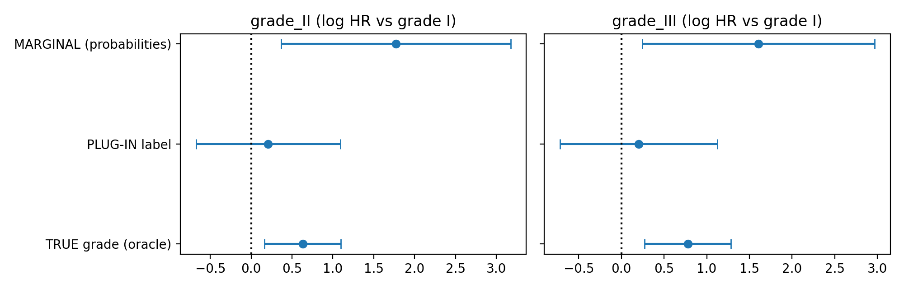

# Propagating extraction uncertainty into time-to-event models

A small, reproducible study of what happens when a clinical variable (tumour grade)
is *extracted from report text* with a probabilistic classifier and then used in a
survival model.

## Motivation
In data-driven oncology, covariates often come from free-text medical reports via
NLP. Extraction is never perfect. If the model treats extracted values as exact,
estimates can be biased and overconfident. This project compares ways of
propagating extraction uncertainty into a downstream time-to-event model.

## Data
- **Outcomes and covariates:** GBSG2 breast cancer cohort (n = 686, 299 events),
  loaded via `scikit-survival`.
- **Reports:** **synthetic** pathology-style sentences generated from the true tumour
  grade, with deliberate ambiguity (about 30% of phrases come from a neighbouring grade).
  Real clinical reports are not public, so this is a controlled testbed, not real NLP.

## Pipeline
1. **Extractor:** TF-IDF + logistic regression; probabilities from 5-fold
   out-of-fold prediction (no leakage).
2. **Uncertainty check:** accuracy 0.692; Expected Calibration Error 0.035
   (6 quantile bins, about 114 patients each, so bin-level noise is about 4 points).
3. **Survival models**, with grade effects relative to grade I:
   - Oracle (true grade), plug-in (hard predicted label), naive multiple imputation
     (100 draws, Rubin's rules) in a Cox model.
   - Weibull model with grade as a latent variable, marginalised over the
     extractor probabilities, plus a weak N(0, 1.5²) prior on grade effects for
     identifiability (applied to all three Weibull fits).

## Results (log hazard ratios vs grade I)
| Model | Method | Grade II | Grade III |
|---|---|---|---|
| Cox | True grade | 0.647 | 0.790 |
| Cox | Plug-in label | 0.237 | 0.243 |
| Cox | Naive MI | 0.009 | 0.040 |
| Weibull (penalised) | True grade | 0.630 | 0.778 |
| Weibull (penalised) | Plug-in label | 0.207 | 0.203 |
| Weibull (penalised) | Marginal (probabilities) | 1.771 | 1.606 |

## Findings (this dataset, one run)
- Hard extracted labels shrank the grade effects by roughly two thirds and widened
  the confidence intervals so they included 0.
- Naive multiple imputation, which ignores the outcome when imputing, removed the effect almost
  entirely, despite well-calibrated probabilities.
- The marginal latent-variable model gave honest, wide intervals compatible with
  the true-grade estimates, but its point estimates overshot. An unpenalised version
  was not identified (coefficients about 21, huge standard errors).

## Limitations
- Single run on one dataset; no method should be called the winner.
- Synthetic report text; a real extractor would face different error patterns.
- The extractor is weak on grades I and III, which limits the marginal model.
- Marginal-model intervals are Laplace approximations under a weak prior.
- The cause of the marginal model's overshoot was not tested.

## Next steps
Simulation study across many datasets and error rates (bias and interval coverage),
conformal prediction sets for the extractor, and a full Bayesian model in PyMC/NumPyro.
